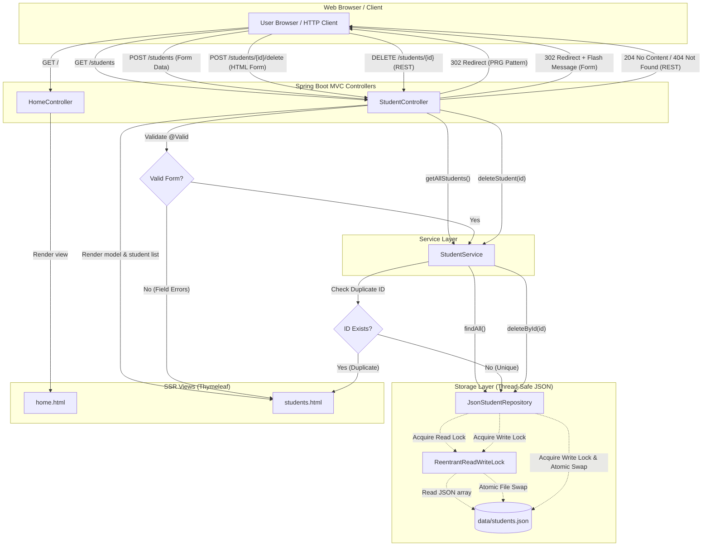

# Student Management System (SSR with Java + Spring Boot)

A Server-Side Rendered (SSR) web application built with Java, Spring Boot 4, and Thymeleaf. The application scope strictly covers **Add**, **List**, and **Delete** student operations. Student data is persisted strictly using a JSON file (`data/students.json`) with thread-safe file operations and zero database/ORM dependencies.

## Members
|Student ID|Name|
|-|-|
|24127052|Phùng Bảo Khang|
|24127345|Nguyễn Minh Đức|
|24127388|Hy Huê Hưng|

---

## Features
- **Server-Side Rendering (SSR):** Powered by Thymeleaf and styled with Bootstrap 5.
- **Pure JSON Storage:** All student data is stored in [`data/students.json`](data/students.json) with `ReentrantReadWriteLock` for concurrency safety and atomic file swapping.
- **Pre-seeded Roster & Retention:** Automatically initializes and seeds the roster with the team members on first run if the file does not exist. An empty student list `[]` (if all students are deleted) is preserved across restarts.
- **Form Validation & Duplicate Check:**
  - Mandatory fields: Student ID, Full Name, Email, Major.
  - Student ID validation: Exactly 8 numeric digits (`^[0-9]{8}$`, e.g., `24127052`).
  - Major validation: Single source of truth via `Major` enum (`Computer Science`, `Software Engineering`, `Information System`, `Cyber Security`).
  - Email format validation.
  - Unique Student ID verification with inline error feedback.
  - Post-Redirect-Get (PRG) pattern with automatic modal re-opening and form input preservation upon validation errors.
- **Record Deletion:**
  - Web UI deletion via `POST /students/{id}/delete` with confirmation dialog and flash message.
  - RESTful deletion via `DELETE /students/{id}` returning standard HTTP status codes.

---

## Data Flow Architecture



---

## Endpoints

| Method | Endpoint | Description |
| :--- | :--- | :--- |
| `GET` | `/` | Landing/Home page with project features, development team roster, and CTA to `/students` |
| `GET` | `/students` | Student Directory page rendering the full list of students, actions, and the "Add Student" modal |
| `POST` | `/students` | Form submission endpoint to add a new student (PRG redirect on success, modal re-open on failure) |
| `POST` | `/students/{id}/delete` | HTML form action to delete a student by ID with confirmation prompt (302 redirect with flash message) |
| `DELETE` | `/students/{id}` | REST endpoint to delete a student by ID (`204 No Content` on success, `404 Not Found` if student ID not found) |

---

## Known Limitations & Security Notes
- **Authentication & CSRF:** This project is intentionally designed for local or classroom demonstration. It does not enforce user authentication or CSRF protection. In production environments, Spring Security with CSRF protection and role-based access control should be configured prior to exposing mutation endpoints.
- **Local Data Reset:** If you previously ran an earlier version of the project, delete your local `data/students.json` file once to allow the application to automatically reseed the clean team roster with the standardized `Major` values.

---

## How to Run

### 1. Run the Application
Execute using the included Maven Wrapper:
```bash
./mvnw spring-boot:run
```
The server will start at: `http://localhost:8080/`

- Access Home page: [http://localhost:8080/](http://localhost:8080/)
- Access Students Directory: [http://localhost:8080/students](http://localhost:8080/students)

### 2. Run Automated Tests
Execute the full test suite (Repository, Service, and Web MVC MockMvc tests isolated from production data):
```bash
./mvnw test
```

### 3. Package to Executable JAR
```bash
./mvnw clean package
java -jar target/student-management-0.0.1-SNAPSHOT.jar
```
